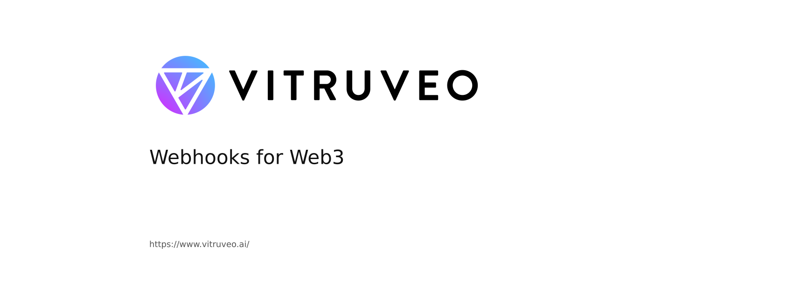
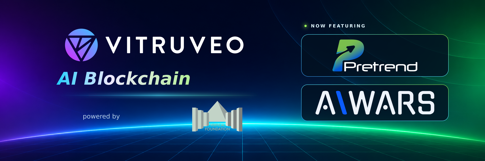

# VTRU brand — versioned review collections

**[V2: clean general templates](v2/README.md)** · **[Browse V2 images](v2/GALLERY.md)** · **[V2 ZIP downloads](downloads/v2/)** · **[Version/provenance guide](VERSIONS.md)**

V2 uses the actual supplied marks and existing website wording. Its working canvases leave space for the team's own imagery. It supplies no newly invented slogans or decorative image panels.

[](v2/social-templates/03-Vitruveo/Facebook/facebook-page-cover.png)

The previous work is retained as **V1 evidence**: [V1 gallery](GALLERY.md), [V1 ZIPs](downloads/README.md), and the [frozen v1.0.0 snapshot](https://github.com/UNI-ASYNC/VTRU-brand/tree/v1.0.0). V1 includes project-created design proposals; they should not be read as legacy official imagery or approved website copy.

The [five original brand kits](source-brand-kits/) remain the source artwork. The existing [Gaps needing technical assistance](DEVELOPER-HANDOFF.md) report and research are also preserved.

<details>
<summary>V1 original delivery notes — preserved for evidence</summary>

# VTRU brand

Vitruveo ecosystem brand assets, image galleries, editable templates, and a source-backed research handoff.

**[Browse the actual images](GALLERY.md)** · **[Gaps needing technical assistance](DEVELOPER-HANDOFF.md)** · **[Read the research report](reports/RESEARCH-REPORT.md)** · **[Download ZIP packs](downloads/README.md)**

## Latest social banner collection

The neon collection follows the supplied blue/purple/green reference and uses the exact original marks from the five source brand kits. There are 79 compositions, each supplied as PNG and editable SVG, across Facebook, X, YouTube, TikTok, Instagram, and Rumble.

[](social-banners/01-Ecosystem-Four-Brands/Master/reference-wide-master.png)

The four-brand version includes Vitruveo, Pretrend, AI Wars, and Vertical Foundation. A separate five-brand version adds VTRU Scope, and individual-brand collections are included.

| Browse | Contents |
|---|---|
| [Image galleries](GALLERY.md) | Actual PNGs, contact sheets, and links to editable masters |
| [Social banners](social-banners/) | 79 neon compositions with platform-specific layouts |
| [Original brand system](brand-system/) | Emojis, stickers, social graphics, avatars, announcements, document headers, stationery, and guides |
| [Original brand kits](source-brand-kits/) | Five supplied ZIPs and all 70 unpacked source SVG/PNG files |
| [Research](reports/) | Existing resources, live-site findings, original-artwork comparisons, and reuse/update inventory |
| [Developer handoff](DEVELOPER-HANDOFF.md) | Prioritized gaps needing technical assistance and acceptance criteria |
| [Reference tools](tools/) | Asset verification and the original production generators |

## What is included

- **Original brand-system collection:** 50 static emojis, 20 static stickers, 15 letterhead layouts in DOCX/PDF/PNG/SVG, 45 social layouts, 15 announcements, 15 avatars, 10 document headers, five ecosystem layouts, an identity sheet, guides, previews, and audits.
- **Latest neon collection:** 79 PNGs and 79 editable SVGs, two shared decorative backgrounds, a nine-page preview PDF, contact sheets, and audit manifests.
- **Source artwork:** Vitruveo, Vertical Foundation, Pretrend, AI Wars, and VTRU Scope. The five public brand-center ZIPs were compared with the uploaded ZIPs: archive bytes and all 70 member hashes matched.
- **Research handoff:** site-specific findings checked on November 13, 2026, including existing favicons, documentation, product surfaces, share-preview metadata, and items needing confirmation.

## Download and edit

Use GitHub's **Code → Download ZIP** to download the repository with its folders intact. The [downloads folder](downloads/README.md) also contains the two original complete delivery ZIPs and eight smaller ZIPs, each under 10 MB.

For direct publishing, select the PNG in the relevant platform folder. For editing, preserve the folder structure: neon SVGs reference the shared background PNGs in `social-banners/00-Guide-and-Audit/Backgrounds/`. Source logos are embedded in the SVGs. Template fonts and their license are included in the collections.

TikTok and Instagram files are content-cover, feed, or Story/Reel formats. YouTube channel layouts keep important content inside their central crop area. Review the platform's upload crop before publishing.

## Review context

The supplied logo geometry, lettering, and colors are preserved. New backgrounds, framing, layouts, supporting colors, and sample copy are design proposals. The research report records public-site observations and identifies details needing confirmation; it is intended to support a collaborative developer review.

Brand marks retain their owners' rights. Publishing this review repository does not create a new license grant for third-party marks, fonts, or artwork. Font-license notices are included with the fonts.

For local integrity verification:

```sh
python3 tools/verify_assets.py
```

</details>
