# VTRU Scope — brand-system gallery

[All galleries](../GALLERY.md) · [Repository home](../README.md)

Open any image for full resolution. Editable SVG, PDF and DOCX files are linked beside the relevant design.

## Social Banners

### discord-server

960 × 540 px · [PNG](../brand-system/05-VTRU-Scope/Social-Banners/vtruscope-discord-server.png) · [SVG](../brand-system/05-VTRU-Scope/Social-Banners/vtruscope-discord-server.svg)

### facebook-cover

1640 × 720 px · [PNG](../brand-system/05-VTRU-Scope/Social-Banners/vtruscope-facebook-cover.png) · [SVG](../brand-system/05-VTRU-Scope/Social-Banners/vtruscope-facebook-cover.svg)

<a href="../brand-system/05-VTRU-Scope/Social-Banners/vtruscope-facebook-cover.png">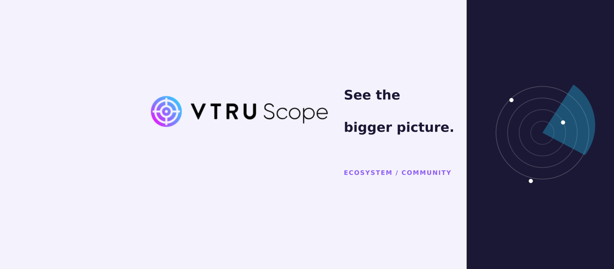</a>

### linkedin-company

1512 × 256 px · [PNG](../brand-system/05-VTRU-Scope/Social-Banners/vtruscope-linkedin-company.png) · [SVG](../brand-system/05-VTRU-Scope/Social-Banners/vtruscope-linkedin-company.svg)

### linkedin-personal

1584 × 396 px · [PNG](../brand-system/05-VTRU-Scope/Social-Banners/vtruscope-linkedin-personal.png) · [SVG](../brand-system/05-VTRU-Scope/Social-Banners/vtruscope-linkedin-personal.svg)

### social-landscape

1200 × 630 px · [PNG](../brand-system/05-VTRU-Scope/Social-Banners/vtruscope-social-landscape.png) · [SVG](../brand-system/05-VTRU-Scope/Social-Banners/vtruscope-social-landscape.svg)

### social-square

1080 × 1080 px · [PNG](../brand-system/05-VTRU-Scope/Social-Banners/vtruscope-social-square.png) · [SVG](../brand-system/05-VTRU-Scope/Social-Banners/vtruscope-social-square.svg)

<a href="../brand-system/05-VTRU-Scope/Social-Banners/vtruscope-social-square.png">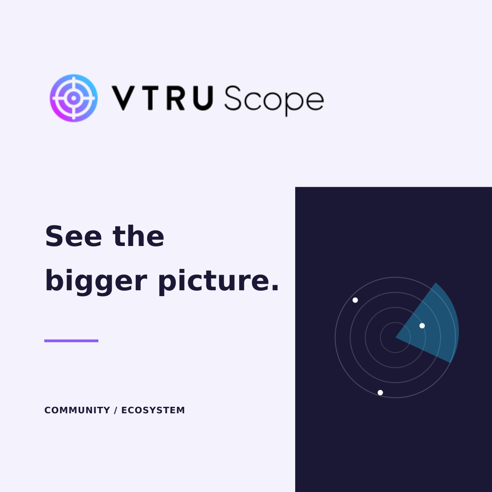</a>

### story-vertical

1080 × 1920 px · [PNG](../brand-system/05-VTRU-Scope/Social-Banners/vtruscope-story-vertical.png) · [SVG](../brand-system/05-VTRU-Scope/Social-Banners/vtruscope-story-vertical.svg)

<a href="../brand-system/05-VTRU-Scope/Social-Banners/vtruscope-story-vertical.png">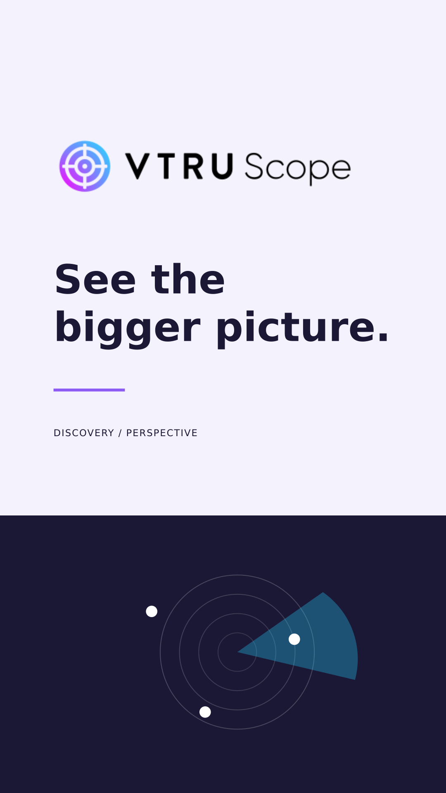</a>

### website-hero

1920 × 640 px · [PNG](../brand-system/05-VTRU-Scope/Social-Banners/vtruscope-website-hero.png) · [SVG](../brand-system/05-VTRU-Scope/Social-Banners/vtruscope-website-hero.svg)

<a href="../brand-system/05-VTRU-Scope/Social-Banners/vtruscope-website-hero.png">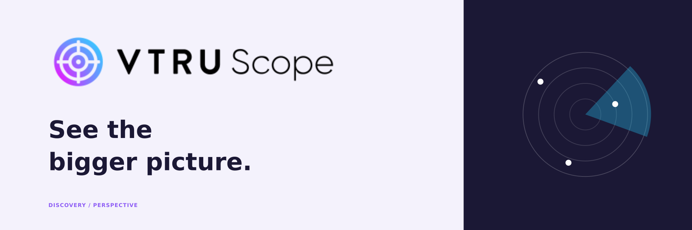</a>

### x-banner

1500 × 500 px · [PNG](../brand-system/05-VTRU-Scope/Social-Banners/vtruscope-x-banner.png) · [SVG](../brand-system/05-VTRU-Scope/Social-Banners/vtruscope-x-banner.svg)

## Announcement Templates

### announcement

1080 × 1080 px · [PNG](../brand-system/05-VTRU-Scope/Announcement-Templates/vtruscope-announcement.png) · [SVG](../brand-system/05-VTRU-Scope/Announcement-Templates/vtruscope-announcement.svg)

### event

1080 × 1080 px · [PNG](../brand-system/05-VTRU-Scope/Announcement-Templates/vtruscope-event.png) · [SVG](../brand-system/05-VTRU-Scope/Announcement-Templates/vtruscope-event.svg)

<a href="../brand-system/05-VTRU-Scope/Announcement-Templates/vtruscope-event.png">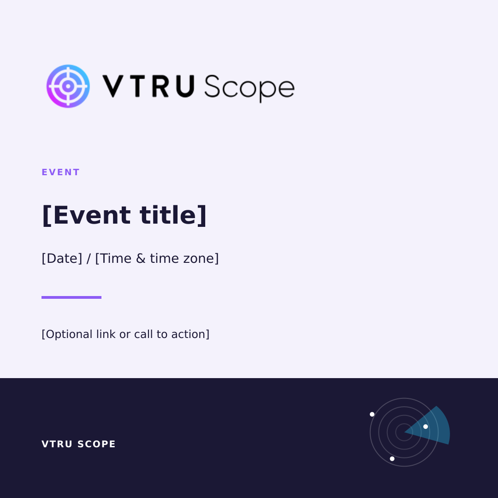</a>

### update

1080 × 1080 px · [PNG](../brand-system/05-VTRU-Scope/Announcement-Templates/vtruscope-update.png) · [SVG](../brand-system/05-VTRU-Scope/Announcement-Templates/vtruscope-update.svg)

<a href="../brand-system/05-VTRU-Scope/Announcement-Templates/vtruscope-update.png">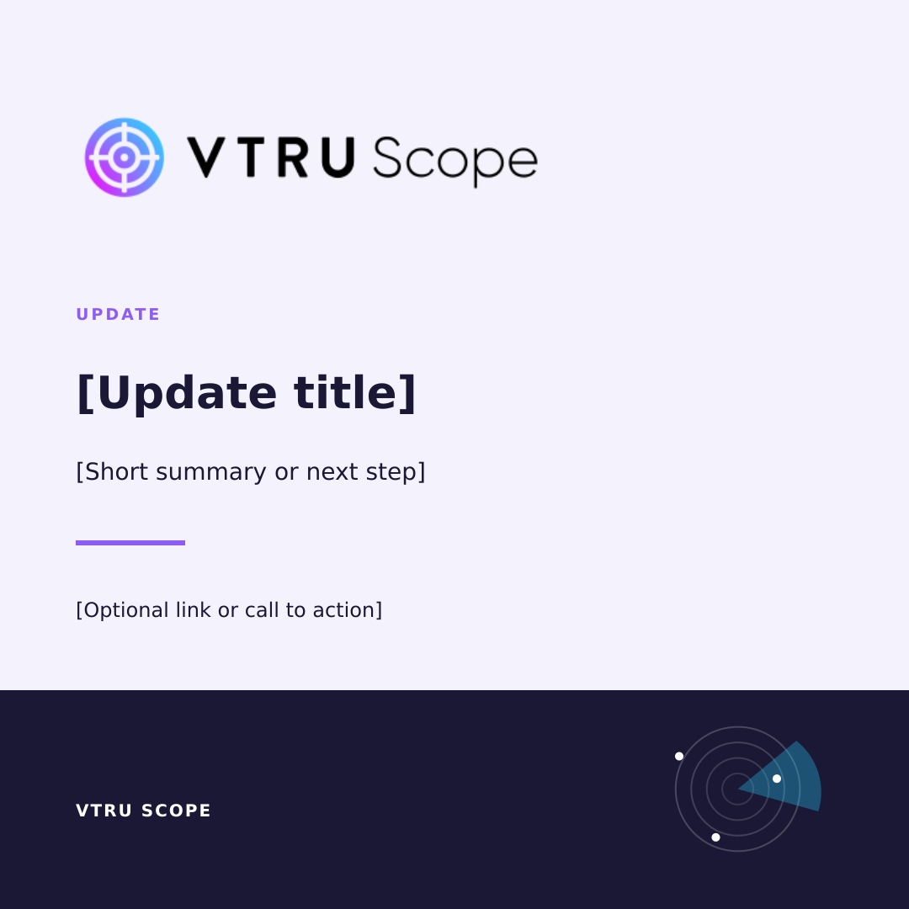</a>

## Profile Images

| Preview | File and master |
|---|---|
|  | **vtruscope-avatar-dark** 1024 × 1024 px [PNG](../brand-system/05-VTRU-Scope/Profile-Images/vtruscope-avatar-dark.png) · [SVG](../brand-system/05-VTRU-Scope/Profile-Images/vtruscope-avatar-dark.svg) |
| <a href="../brand-system/05-VTRU-Scope/Profile-Images/vtruscope-avatar-framed.png">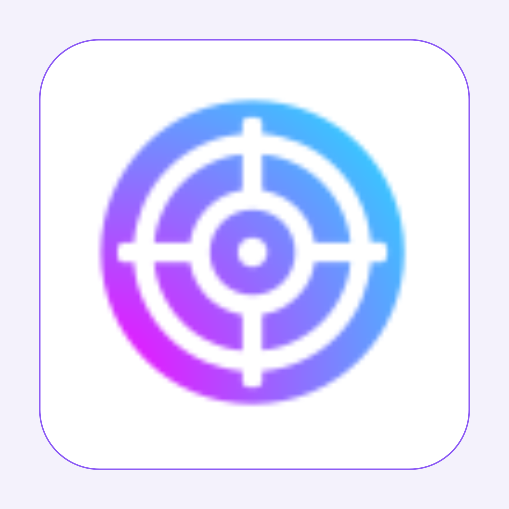</a> | **vtruscope-avatar-framed** 1024 × 1024 px [PNG](../brand-system/05-VTRU-Scope/Profile-Images/vtruscope-avatar-framed.png) · [SVG](../brand-system/05-VTRU-Scope/Profile-Images/vtruscope-avatar-framed.svg) |
|  | **vtruscope-avatar-light** 1024 × 1024 px [PNG](../brand-system/05-VTRU-Scope/Profile-Images/vtruscope-avatar-light.png) · [SVG](../brand-system/05-VTRU-Scope/Profile-Images/vtruscope-avatar-light.svg) |

## Document Headers

### document-header-dark

1600 × 320 px · [PNG](../brand-system/05-VTRU-Scope/Document-Headers/vtruscope-document-header-dark.png) · [SVG](../brand-system/05-VTRU-Scope/Document-Headers/vtruscope-document-header-dark.svg)

### document-header-light

1600 × 320 px · [PNG](../brand-system/05-VTRU-Scope/Document-Headers/vtruscope-document-header-light.png) · [SVG](../brand-system/05-VTRU-Scope/Document-Headers/vtruscope-document-header-light.svg)

## Emojis

| Preview | File and master |
|---|---|
|  | **vtruscope-emoji-01-chart** 128 × 128 px [PNG](../brand-system/05-VTRU-Scope/Emojis/vtruscope-emoji-01-chart.png) · [SVG](../brand-system/05-VTRU-Scope/Emojis/vtruscope-emoji-01-chart.svg) |
|  | **vtruscope-emoji-02-search** 128 × 128 px [PNG](../brand-system/05-VTRU-Scope/Emojis/vtruscope-emoji-02-search.png) · [SVG](../brand-system/05-VTRU-Scope/Emojis/vtruscope-emoji-02-search.svg) |
|  | **vtruscope-emoji-03-signal** 128 × 128 px [PNG](../brand-system/05-VTRU-Scope/Emojis/vtruscope-emoji-03-signal.png) · [SVG](../brand-system/05-VTRU-Scope/Emojis/vtruscope-emoji-03-signal.svg) |
|  | **vtruscope-emoji-04-report** 128 × 128 px [PNG](../brand-system/05-VTRU-Scope/Emojis/vtruscope-emoji-04-report.png) · [SVG](../brand-system/05-VTRU-Scope/Emojis/vtruscope-emoji-04-report.svg) |
|  | **vtruscope-emoji-05-status** 128 × 128 px [PNG](../brand-system/05-VTRU-Scope/Emojis/vtruscope-emoji-05-status.png) · [SVG](../brand-system/05-VTRU-Scope/Emojis/vtruscope-emoji-05-status.svg) |
|  | **vtruscope-emoji-06-filter** 128 × 128 px [PNG](../brand-system/05-VTRU-Scope/Emojis/vtruscope-emoji-06-filter.png) · [SVG](../brand-system/05-VTRU-Scope/Emojis/vtruscope-emoji-06-filter.svg) |
|  | **vtruscope-emoji-07-compare** 128 × 128 px [PNG](../brand-system/05-VTRU-Scope/Emojis/vtruscope-emoji-07-compare.png) · [SVG](../brand-system/05-VTRU-Scope/Emojis/vtruscope-emoji-07-compare.svg) |
|  | **vtruscope-emoji-08-insight** 128 × 128 px [PNG](../brand-system/05-VTRU-Scope/Emojis/vtruscope-emoji-08-insight.png) · [SVG](../brand-system/05-VTRU-Scope/Emojis/vtruscope-emoji-08-insight.svg) |
| <a href="../brand-system/05-VTRU-Scope/Emojis/vtruscope-emoji-09-alert.png">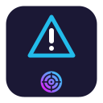</a> | **vtruscope-emoji-09-alert** 128 × 128 px [PNG](../brand-system/05-VTRU-Scope/Emojis/vtruscope-emoji-09-alert.png) · [SVG](../brand-system/05-VTRU-Scope/Emojis/vtruscope-emoji-09-alert.svg) |
|  | **vtruscope-emoji-10-verified** 128 × 128 px [PNG](../brand-system/05-VTRU-Scope/Emojis/vtruscope-emoji-10-verified.png) · [SVG](../brand-system/05-VTRU-Scope/Emojis/vtruscope-emoji-10-verified.svg) |

## Stickers

| Preview | File and master |
|---|---|
|  | **vtruscope-sticker-01-data-live** 320 × 320 px [PNG](../brand-system/05-VTRU-Scope/Stickers/vtruscope-sticker-01-data-live.png) · [SVG](../brand-system/05-VTRU-Scope/Stickers/vtruscope-sticker-01-data-live.svg) |
| <a href="../brand-system/05-VTRU-Scope/Stickers/vtruscope-sticker-02-verified.png">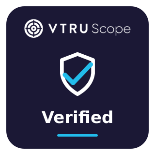</a> | **vtruscope-sticker-02-verified** 320 × 320 px [PNG](../brand-system/05-VTRU-Scope/Stickers/vtruscope-sticker-02-verified.png) · [SVG](../brand-system/05-VTRU-Scope/Stickers/vtruscope-sticker-02-verified.svg) |
| <a href="../brand-system/05-VTRU-Scope/Stickers/vtruscope-sticker-03-alert.png">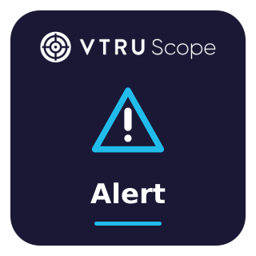</a> | **vtruscope-sticker-03-alert** 320 × 320 px [PNG](../brand-system/05-VTRU-Scope/Stickers/vtruscope-sticker-03-alert.png) · [SVG](../brand-system/05-VTRU-Scope/Stickers/vtruscope-sticker-03-alert.svg) |
|  | **vtruscope-sticker-04-insight** 320 × 320 px [PNG](../brand-system/05-VTRU-Scope/Stickers/vtruscope-sticker-04-insight.png) · [SVG](../brand-system/05-VTRU-Scope/Stickers/vtruscope-sticker-04-insight.svg) |

## Letterheads

### letterhead-formal-A4-300dpi

2480 × 3508 px · [PNG](../brand-system/05-VTRU-Scope/Letterheads/vtruscope-letterhead-formal-A4-300dpi.png) · [SVG](../brand-system/05-VTRU-Scope/Letterheads/vtruscope-letterhead-formal-A4.svg) · [PDF](../brand-system/05-VTRU-Scope/Letterheads/vtruscope-letterhead-formal-A4.pdf) · [DOCX](../brand-system/05-VTRU-Scope/Letterheads/vtruscope-letterhead-formal-A4.docx)

<a href="../brand-system/05-VTRU-Scope/Letterheads/vtruscope-letterhead-formal-A4-300dpi.png">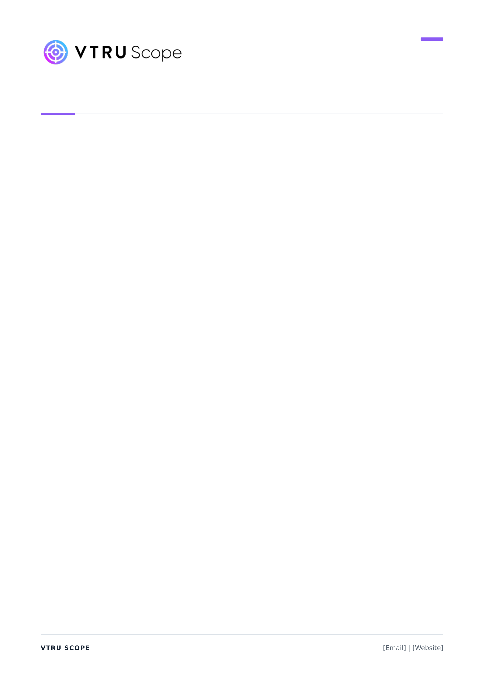</a>

### letterhead-office-A4-300dpi

2480 × 3508 px · [PNG](../brand-system/05-VTRU-Scope/Letterheads/vtruscope-letterhead-office-A4-300dpi.png) · [SVG](../brand-system/05-VTRU-Scope/Letterheads/vtruscope-letterhead-office-A4.svg) · [PDF](../brand-system/05-VTRU-Scope/Letterheads/vtruscope-letterhead-office-A4.pdf) · [DOCX](../brand-system/05-VTRU-Scope/Letterheads/vtruscope-letterhead-office-A4.docx)

<a href="../brand-system/05-VTRU-Scope/Letterheads/vtruscope-letterhead-office-A4-300dpi.png">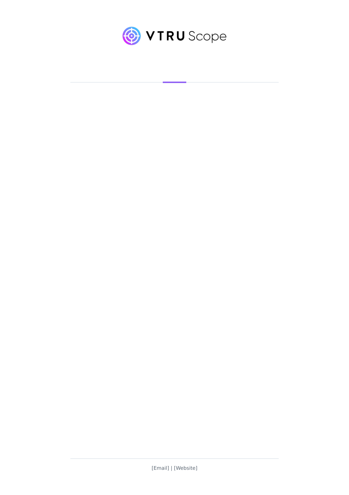</a>

### letterhead-technical-A4-300dpi

2480 × 3508 px · [PNG](../brand-system/05-VTRU-Scope/Letterheads/vtruscope-letterhead-technical-A4-300dpi.png) · [SVG](../brand-system/05-VTRU-Scope/Letterheads/vtruscope-letterhead-technical-A4.svg) · [PDF](../brand-system/05-VTRU-Scope/Letterheads/vtruscope-letterhead-technical-A4.pdf) · [DOCX](../brand-system/05-VTRU-Scope/Letterheads/vtruscope-letterhead-technical-A4.docx)

## Contact sheets

- [Social contact sheet](../brand-system/07-Previews-and-Contact-Sheets/vtruscope-social-contact-sheet.png)
- [Discord contact sheet](../brand-system/07-Previews-and-Contact-Sheets/vtruscope-discord-contact-sheet.png)
- [Letterheads contact sheet](../brand-system/07-Previews-and-Contact-Sheets/vtruscope-letterheads-contact-sheet.png)

[Complete brand-system preview PDF](../brand-system/07-Previews-and-Contact-Sheets/Complete-Preview-Book.pdf)
