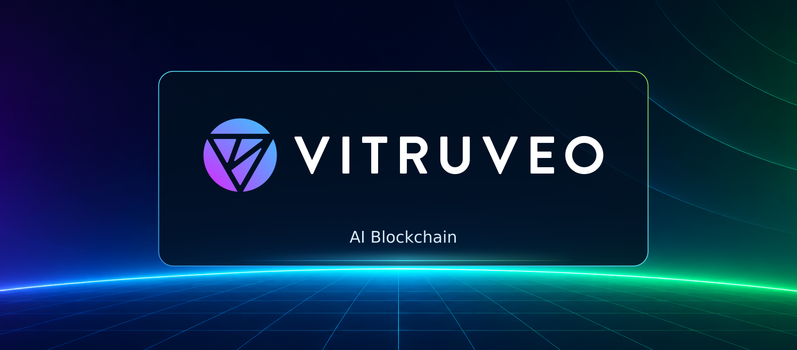
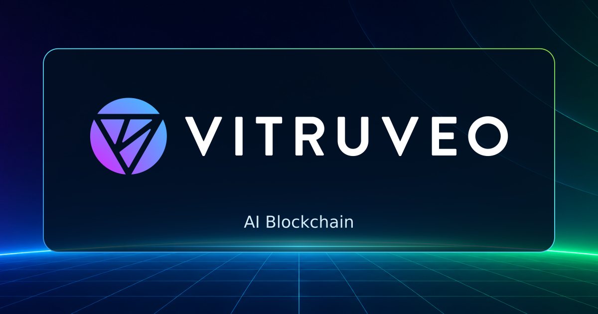
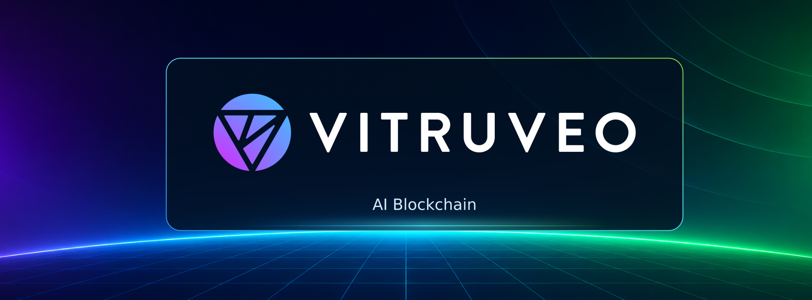
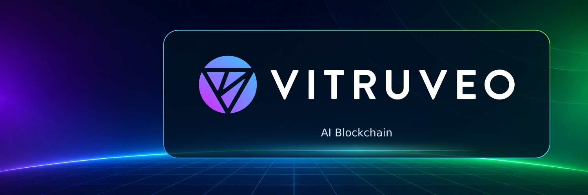
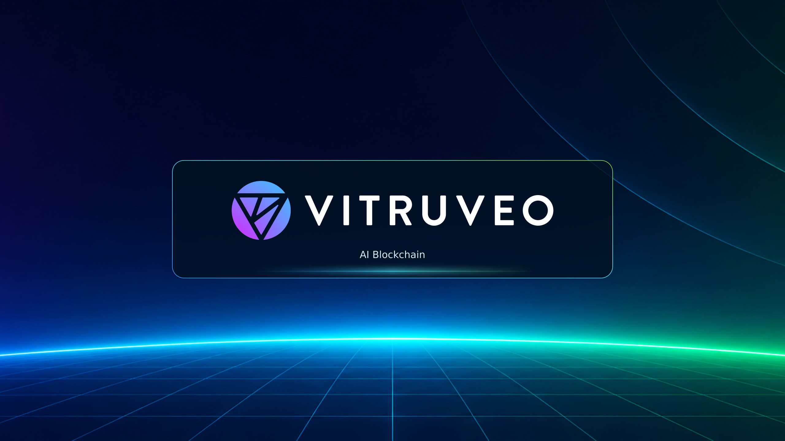
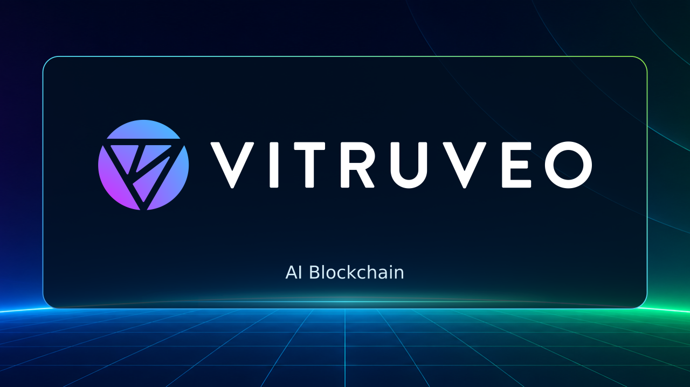
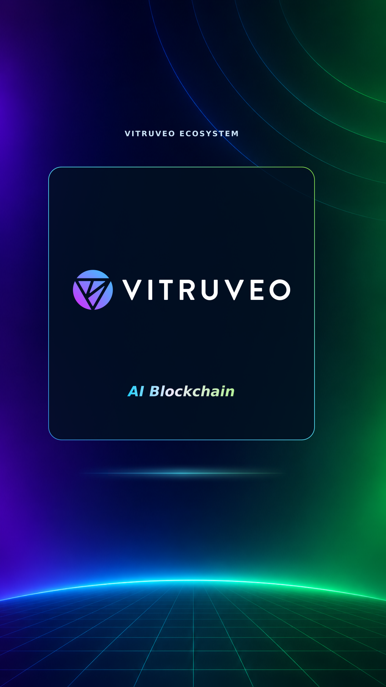
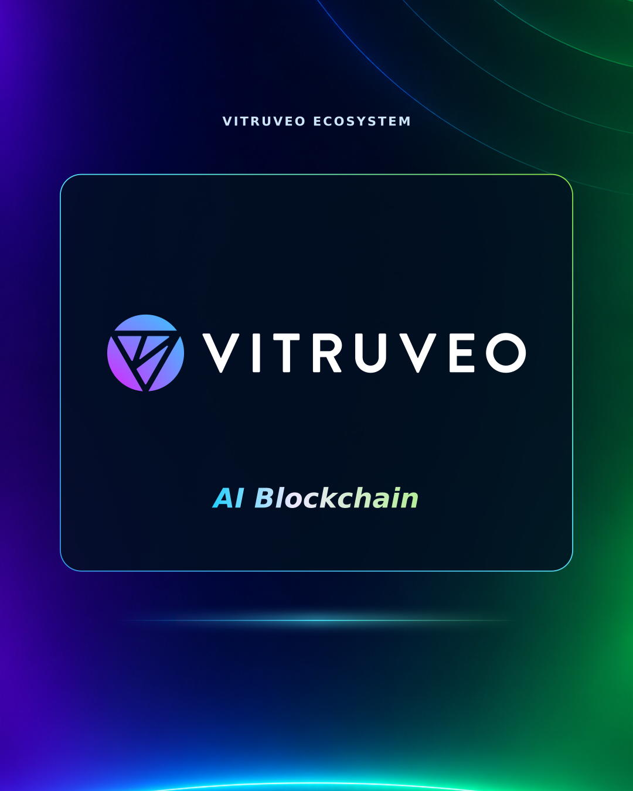
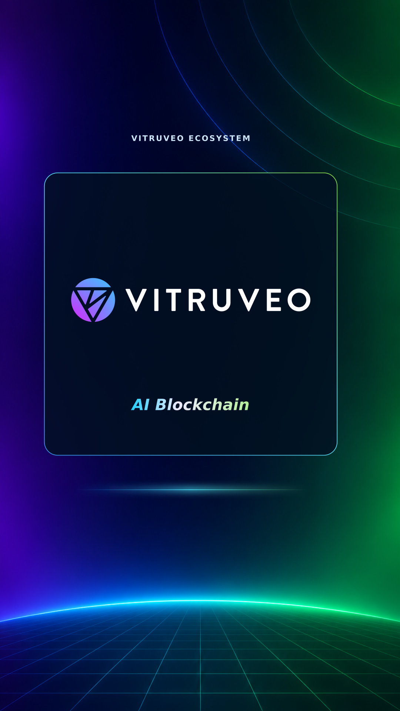
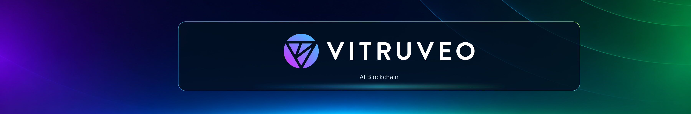

# Vitruveo — neon social banners

[All galleries](../GALLERY.md) · [Repository home](../README.md)

PNG previews are the upload-ready images. SVGs are editable masters. Keep the shared `00-Guide-and-Audit/Backgrounds/` directory with the masters when downloading or editing.

## Facebook

### facebook cover mobile friendly

1640 × 720 px · [PNG](../social-banners/03-Vitruveo/Facebook/facebook-cover-mobile-friendly.png) · [SVG](../social-banners/03-Vitruveo/Facebook/facebook-cover-mobile-friendly.svg)

### facebook feed landscape

1200 × 630 px · [PNG](../social-banners/03-Vitruveo/Facebook/facebook-feed-landscape.png) · [SVG](../social-banners/03-Vitruveo/Facebook/facebook-feed-landscape.svg)

### facebook page cover

1702 × 630 px · [PNG](../social-banners/03-Vitruveo/Facebook/facebook-page-cover.png) · [SVG](../social-banners/03-Vitruveo/Facebook/facebook-page-cover.svg)

## X

### x profile banner

1500 × 500 px · [PNG](../social-banners/03-Vitruveo/X/x-profile-banner.png) · [SVG](../social-banners/03-Vitruveo/X/x-profile-banner.svg)

## YouTube

### youtube channel banner

2560 × 1440 px · [PNG](../social-banners/03-Vitruveo/YouTube/youtube-channel-banner.png) · [SVG](../social-banners/03-Vitruveo/YouTube/youtube-channel-banner.svg)

### youtube video thumbnail

1280 × 720 px · [PNG](../social-banners/03-Vitruveo/YouTube/youtube-video-thumbnail.png) · [SVG](../social-banners/03-Vitruveo/YouTube/youtube-video-thumbnail.svg)

## TikTok

Use the named content-cover, feed, Story or Reel format.

### tiktok vertical cover

1080 × 1920 px · [PNG](../social-banners/03-Vitruveo/TikTok/tiktok-vertical-cover.png) · [SVG](../social-banners/03-Vitruveo/TikTok/tiktok-vertical-cover.svg)

## Instagram

Use the named content-cover, feed, Story or Reel format.

### instagram feed portrait

1080 × 1350 px · [PNG](../social-banners/03-Vitruveo/Instagram/instagram-feed-portrait.png) · [SVG](../social-banners/03-Vitruveo/Instagram/instagram-feed-portrait.svg)

### instagram feed square

1080 × 1080 px · [PNG](../social-banners/03-Vitruveo/Instagram/instagram-feed-square.png) · [SVG](../social-banners/03-Vitruveo/Instagram/instagram-feed-square.svg)

### instagram story reel cover

1080 × 1920 px · [PNG](../social-banners/03-Vitruveo/Instagram/instagram-story-reel-cover.png) · [SVG](../social-banners/03-Vitruveo/Instagram/instagram-story-reel-cover.svg)

## Rumble

### rumble channel backsplash

3600 × 600 px · [PNG](../social-banners/03-Vitruveo/Rumble/rumble-channel-backsplash.png) · [SVG](../social-banners/03-Vitruveo/Rumble/rumble-channel-backsplash.svg)

[Complete neon preview PDF](../social-banners/08-Previews/Neon-Social-Banners-Preview.pdf)
