# V2 — Source-only template gallery

[V2 overview](README.md) · [Usage guide](USAGE-GUIDE.md) · [Verified website copy](reports/COPY-SOURCES.md) · [V1 evidence gallery](https://github.com/UNI-ASYNC/VTRU-brand/blob/main/GALLERY.md)

These are static image canvases for covers, feed posts, Stories/Reels, video thumbnails, website headers, announcements and stationery. They use the supplied source logos and the recorded existing website wording. The open areas are intentionally reserved for the owner’s existing imagery.

The announcement/document fields in brackets are editable functional placeholders. These canvases are not finished campaign posters, websites or applications.

**[Open the 13-page preview book](previews/VTRU-Brand-V2-Preview.pdf)**

## Browse V2 visually — social banners and posts

Click a contact-sheet preview to open the full gallery, where each actual PNG is displayed at full viewing width with its editable SVG link. These are the existing V2 files, not newly rendered replacements.

<a href="gallery/social-01-ecosystem-four-brands.md">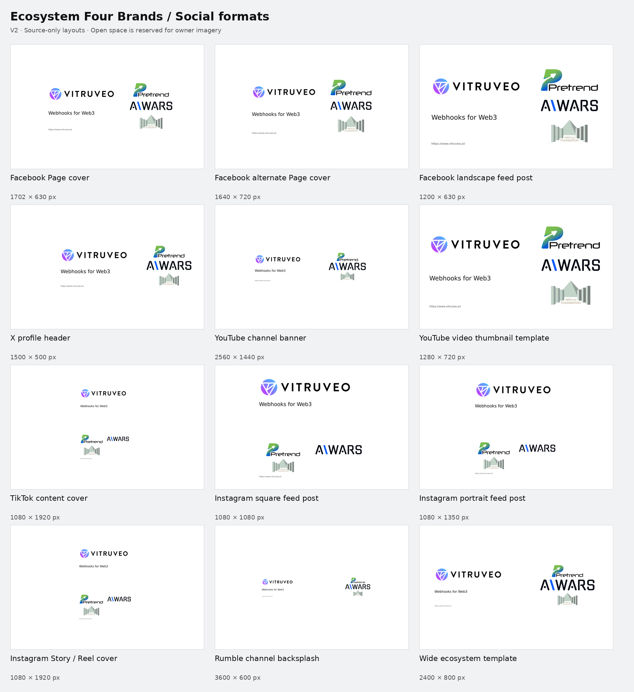</a>

**[Ecosystem — Four Brands — open every image](gallery/social-01-ecosystem-four-brands.md)**

<a href="gallery/social-02-ecosystem-five-brands.md">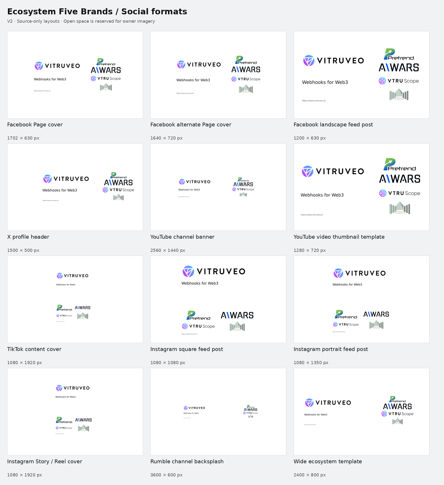</a>

**[Ecosystem — Five Brands — open every image](gallery/social-02-ecosystem-five-brands.md)**

**[Vitruveo — open every image](gallery/social-03-vitruveo.md)**

<a href="gallery/social-04-vertical-foundation.md">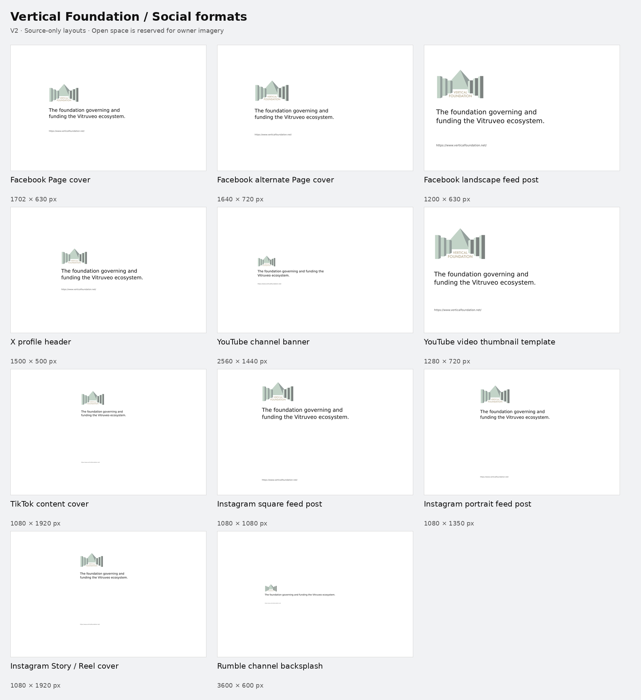</a>

**[Vertical Foundation — open every image](gallery/social-04-vertical-foundation.md)**

<a href="gallery/social-05-pretrend.md">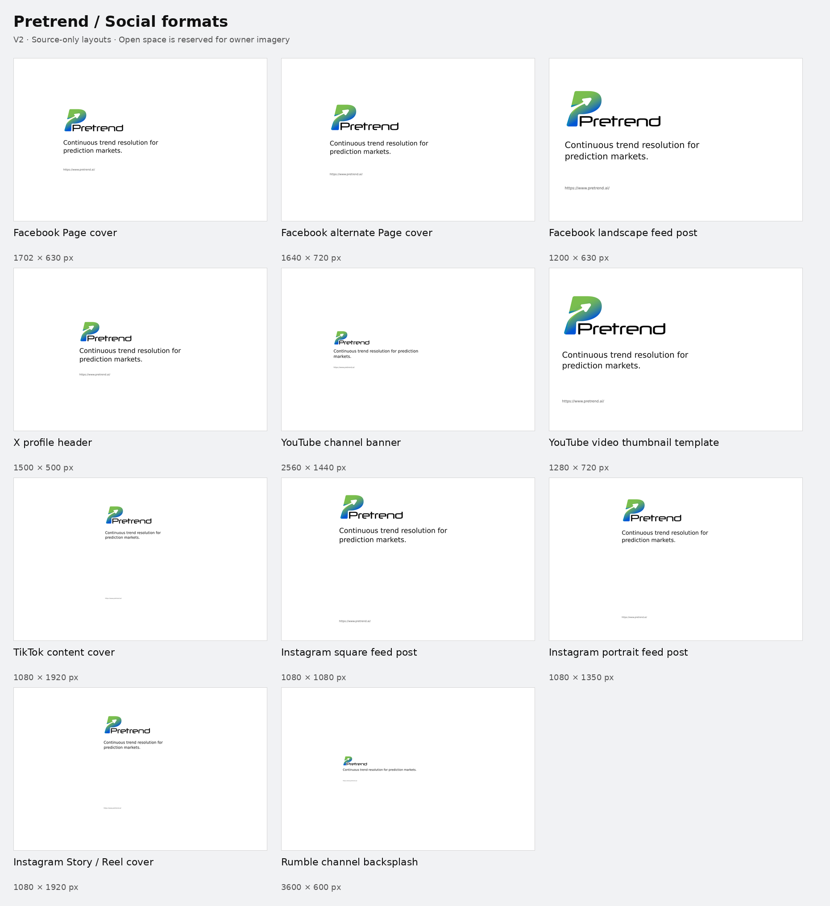</a>

**[Pretrend — open every image](gallery/social-05-pretrend.md)**

<a href="gallery/social-06-ai-wars.md">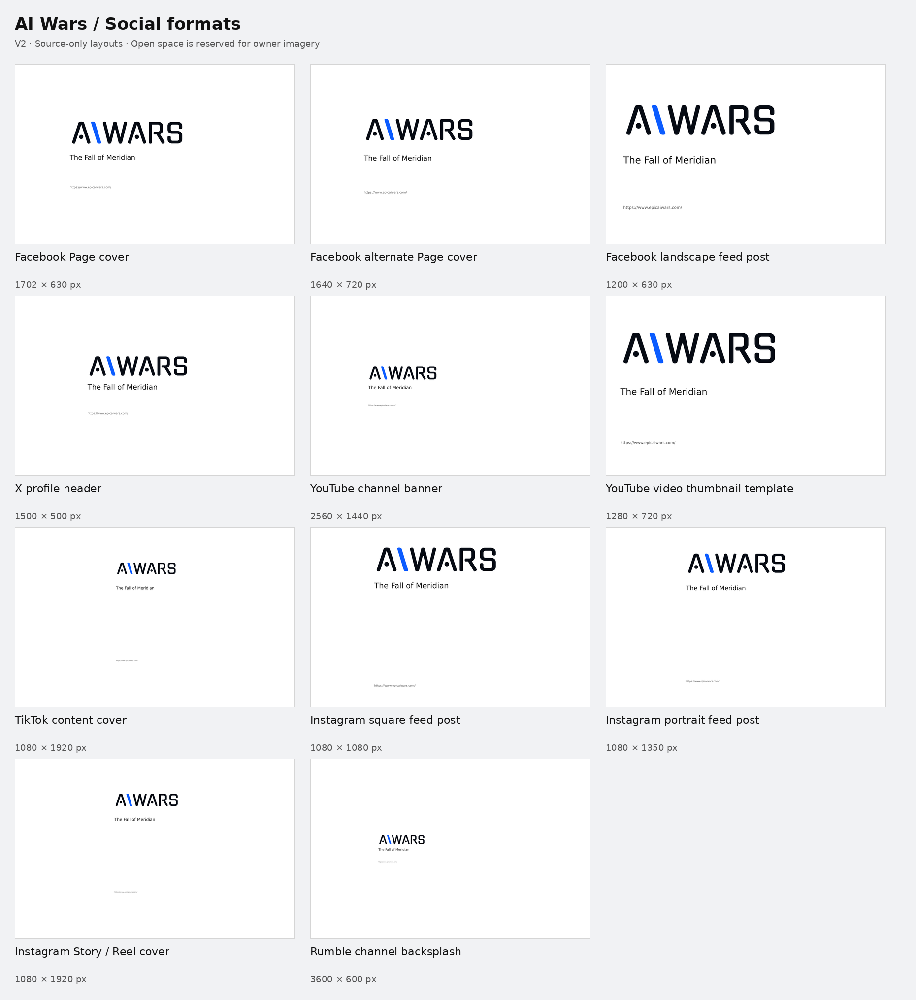</a>

**[AI Wars — open every image](gallery/social-06-ai-wars.md)**

**[VTRU Scope — open every image](gallery/social-07-vtru-scope.md)**

## Browse V2 visually — additional templates

Announcements, Discord artwork, avatars, headers, LinkedIn, websites and letterheads.

<a href="gallery/supplemental-vitruveo.md">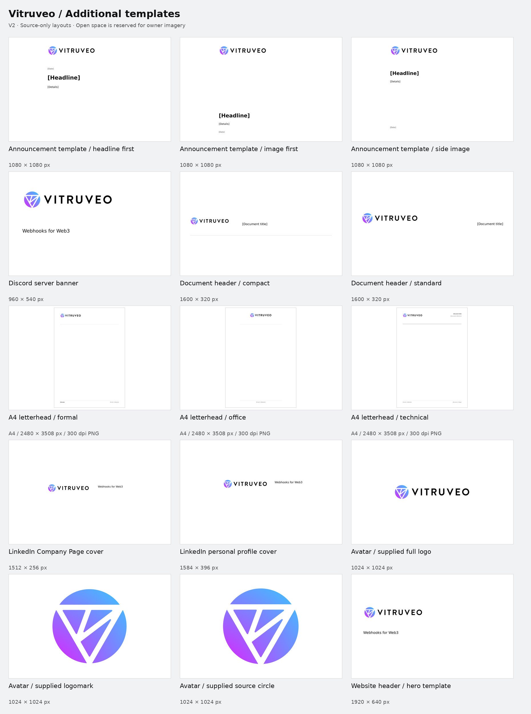</a>

**[Vitruveo — open every image](gallery/supplemental-vitruveo.md)**

<a href="gallery/supplemental-verticalfoundation.md">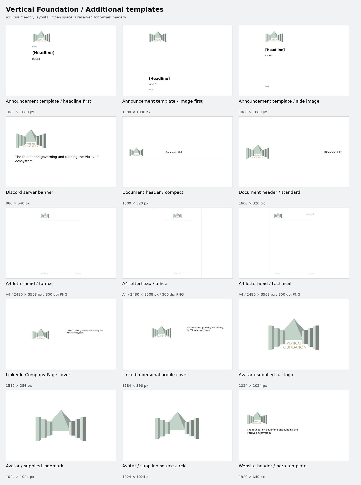</a>

**[Vertical Foundation — open every image](gallery/supplemental-verticalfoundation.md)**

**[Pretrend — open every image](gallery/supplemental-pretrend.md)**

<a href="gallery/supplemental-aiwars.md">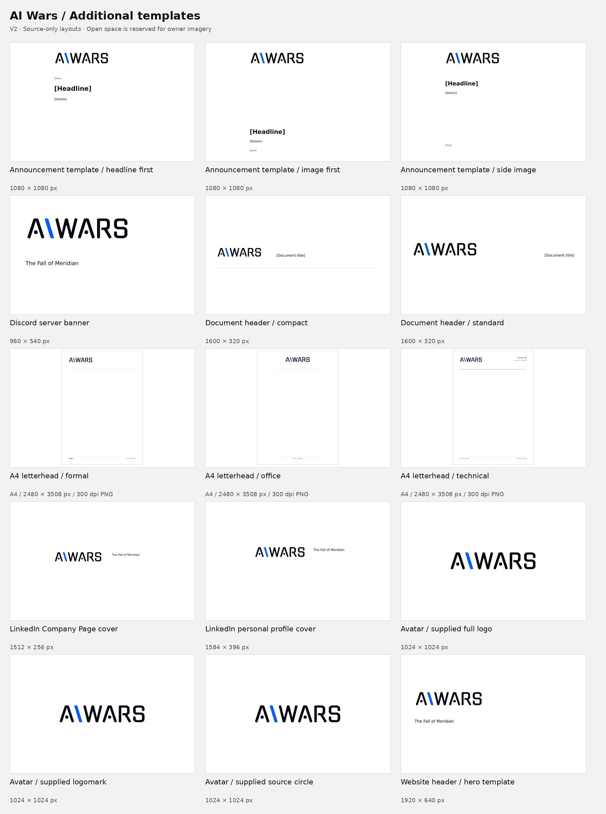</a>

**[AI Wars — open every image](gallery/supplemental-aiwars.md)**

**[VTRU Scope — open every image](gallery/supplemental-vtruscope.md)**

## Representative V2 canvases

### Vitruveo / Facebook Page cover

### Vertical Foundation / Facebook Page cover

### Pretrend / Facebook Page cover

[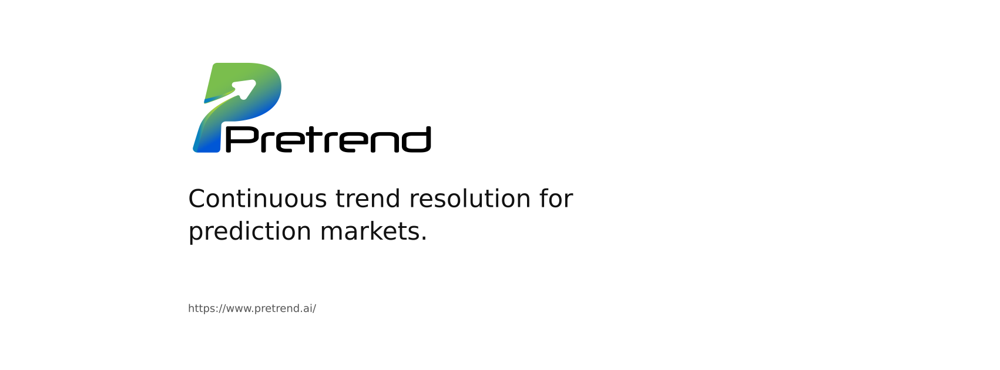](social-templates/05-Pretrend/Facebook/facebook-page-cover.png)

### AI Wars / Facebook Page cover

[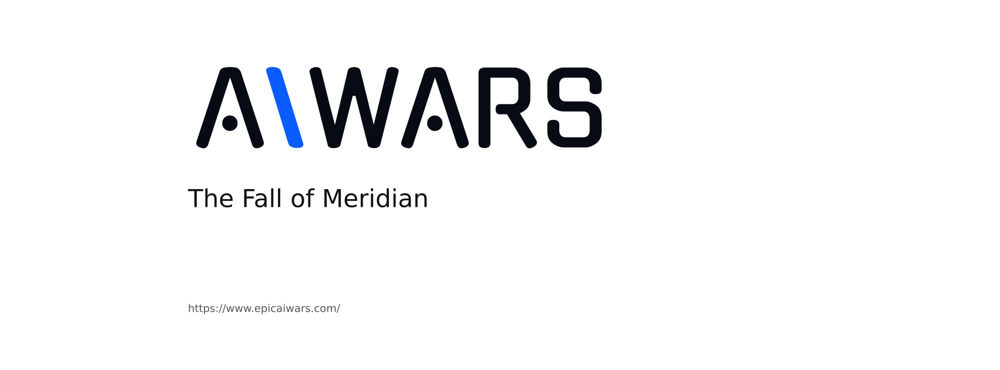](social-templates/06-AI-Wars/Facebook/facebook-page-cover.png)

### VTRU Scope / Facebook Page cover

### Ecosystem Four Brands / Wide ecosystem template

[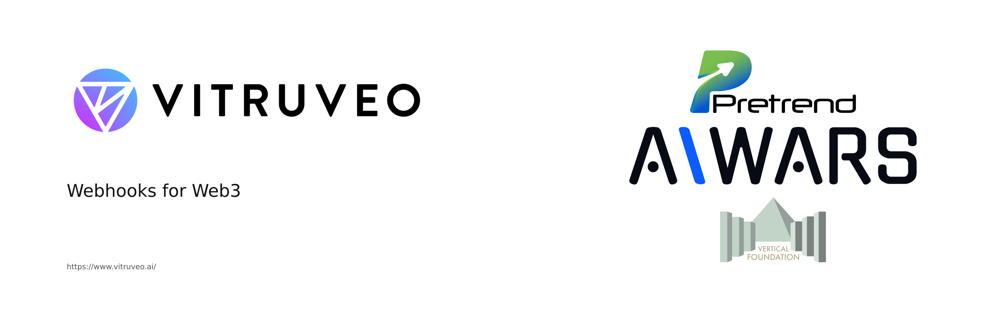](social-templates/01-Ecosystem-Four-Brands/Master/ecosystem-wide-master.png)

### Ecosystem Five Brands / Wide ecosystem template

[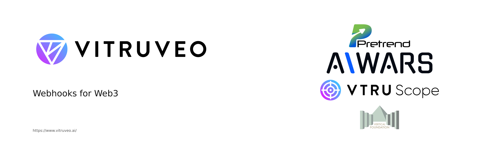](social-templates/02-Ecosystem-Five-Brands/Master/ecosystem-wide-master.png)

V1 artwork, previews, ZIPs and reports remain separate and unchanged as evidence. [Version notes](VERSION-NOTES.md).
