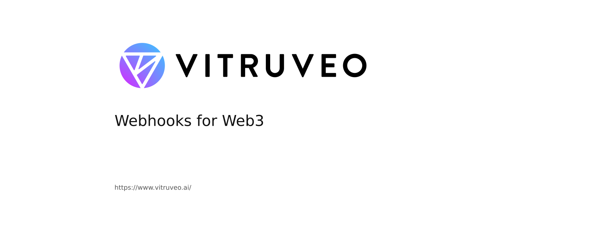
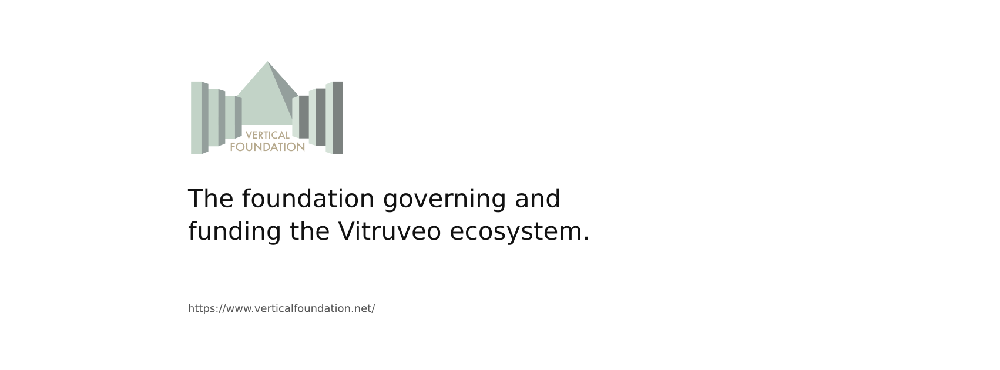
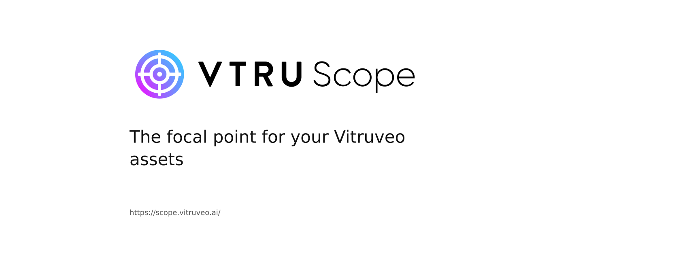

# V2 — Source-only template gallery

[V2 overview](README.md) · [Usage guide](USAGE-GUIDE.md) · [Verified website copy](reports/COPY-SOURCES.md) · [V1 evidence gallery](https://github.com/UNI-ASYNC/VTRU-brand/blob/main/GALLERY.md)

These are static image canvases for covers, feed posts, Stories/Reels, video thumbnails, website headers, announcements and stationery. They use the supplied source logos and the recorded existing website wording. The open areas are intentionally reserved for the owner’s existing imagery.

The announcement/document fields in brackets are editable functional placeholders. These canvases are not finished campaign posters, websites or applications.

**[Open the 13-page preview book](previews/VTRU-Brand-V2-Preview.pdf)**

## Social formats

- [Ecosystem Four Brands: covers, posts and content templates](gallery/social-01-ecosystem-four-brands.md)
- [Ecosystem Five Brands: covers, posts and content templates](gallery/social-02-ecosystem-five-brands.md)
- [Vitruveo: covers, posts and content templates](gallery/social-03-vitruveo.md)
- [Vertical Foundation: covers, posts and content templates](gallery/social-04-vertical-foundation.md)
- [Pretrend: covers, posts and content templates](gallery/social-05-pretrend.md)
- [AI Wars: covers, posts and content templates](gallery/social-06-ai-wars.md)
- [VTRU Scope: covers, posts and content templates](gallery/social-07-vtru-scope.md)

## Additional templates

- [Vitruveo: announcements, headers, avatars, LinkedIn, Discord, website and A4 stationery](gallery/supplemental-vitruveo.md)
- [Vertical Foundation: announcements, headers, avatars, LinkedIn, Discord, website and A4 stationery](gallery/supplemental-verticalfoundation.md)
- [Pretrend: announcements, headers, avatars, LinkedIn, Discord, website and A4 stationery](gallery/supplemental-pretrend.md)
- [AI Wars: announcements, headers, avatars, LinkedIn, Discord, website and A4 stationery](gallery/supplemental-aiwars.md)
- [VTRU Scope: announcements, headers, avatars, LinkedIn, Discord, website and A4 stationery](gallery/supplemental-vtruscope.md)

## Representative V2 canvases

### Vitruveo / Facebook Page cover

### Vertical Foundation / Facebook Page cover

### Pretrend / Facebook Page cover

### AI Wars / Facebook Page cover

### VTRU Scope / Facebook Page cover

### Ecosystem Four Brands / Wide ecosystem template

### Ecosystem Five Brands / Wide ecosystem template

V1 artwork, previews, ZIPs and reports remain separate and unchanged as evidence. [Version notes](VERSION-NOTES.md).
