# V2 — Vitruveo / Social formats

[V2 gallery index](../GALLERY.md) · [Usage guide](../USAGE-GUIDE.md) · [Website-copy sources](../reports/COPY-SOURCES.md)

These are general editable canvases. Empty white areas are deliberately available for the owner’s existing imagery. The preview labels describe their intended use; they are not additional marketing copy.

[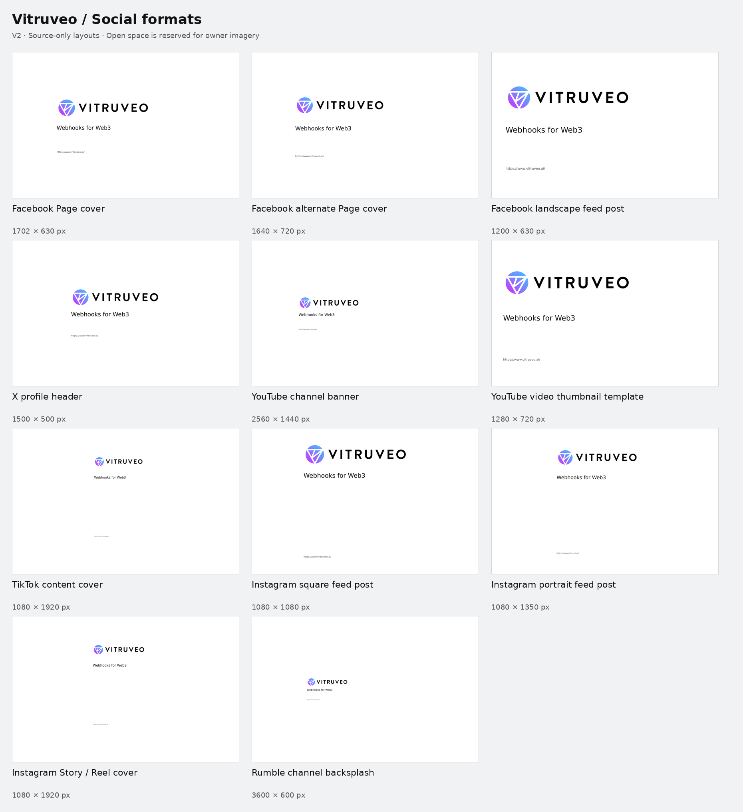](../previews/social-03-vitruveo-contact-sheet.png)

## Facebook Page cover

1702 × 630 px · [PNG](../social-templates/03-Vitruveo/Facebook/facebook-page-cover.png) · [Editable SVG](../social-templates/03-Vitruveo/Facebook/facebook-page-cover.svg)

<a href="../social-templates/03-Vitruveo/Facebook/facebook-page-cover.png">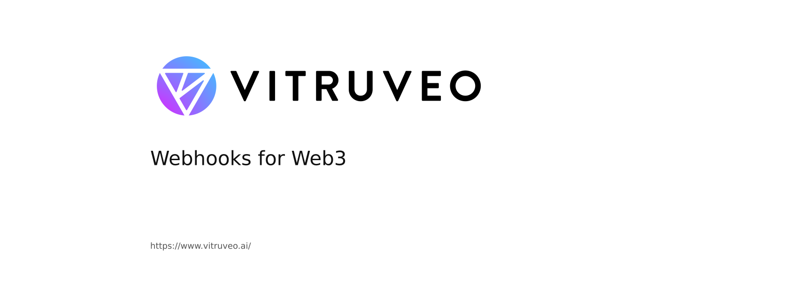</a>

## Facebook alternate Page cover

1640 × 720 px · [PNG](../social-templates/03-Vitruveo/Facebook/facebook-cover-mobile-friendly.png) · [Editable SVG](../social-templates/03-Vitruveo/Facebook/facebook-cover-mobile-friendly.svg)

<a href="../social-templates/03-Vitruveo/Facebook/facebook-cover-mobile-friendly.png">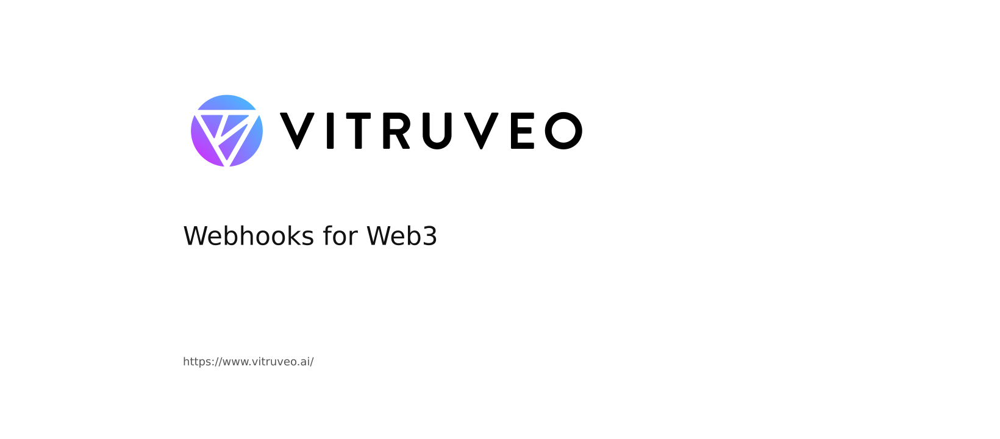</a>

## Facebook landscape feed post

1200 × 630 px · [PNG](../social-templates/03-Vitruveo/Facebook/facebook-feed-landscape.png) · [Editable SVG](../social-templates/03-Vitruveo/Facebook/facebook-feed-landscape.svg)

<a href="../social-templates/03-Vitruveo/Facebook/facebook-feed-landscape.png">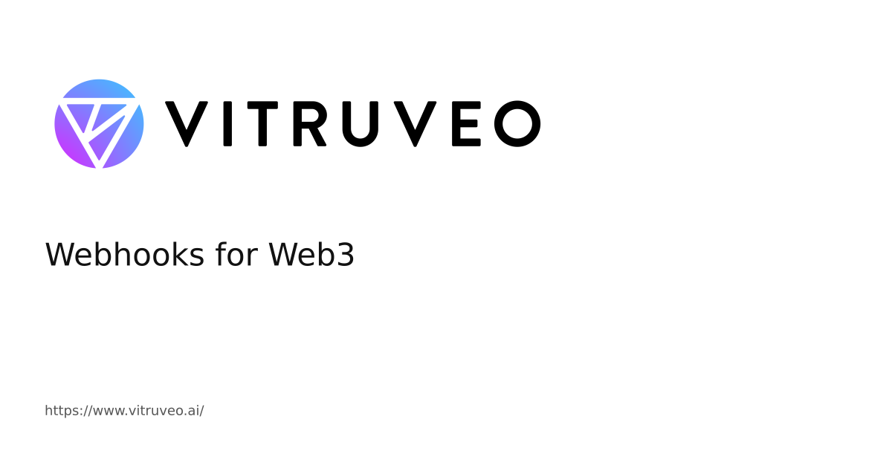</a>

## X profile header

1500 × 500 px · [PNG](../social-templates/03-Vitruveo/X/x-profile-banner.png) · [Editable SVG](../social-templates/03-Vitruveo/X/x-profile-banner.svg)

<a href="../social-templates/03-Vitruveo/X/x-profile-banner.png">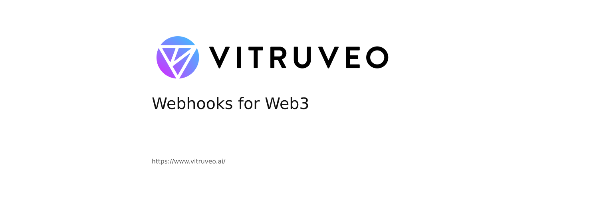</a>

## YouTube channel banner

2560 × 1440 px · [PNG](../social-templates/03-Vitruveo/YouTube/youtube-channel-banner.png) · [Editable SVG](../social-templates/03-Vitruveo/YouTube/youtube-channel-banner.svg)

<a href="../social-templates/03-Vitruveo/YouTube/youtube-channel-banner.png">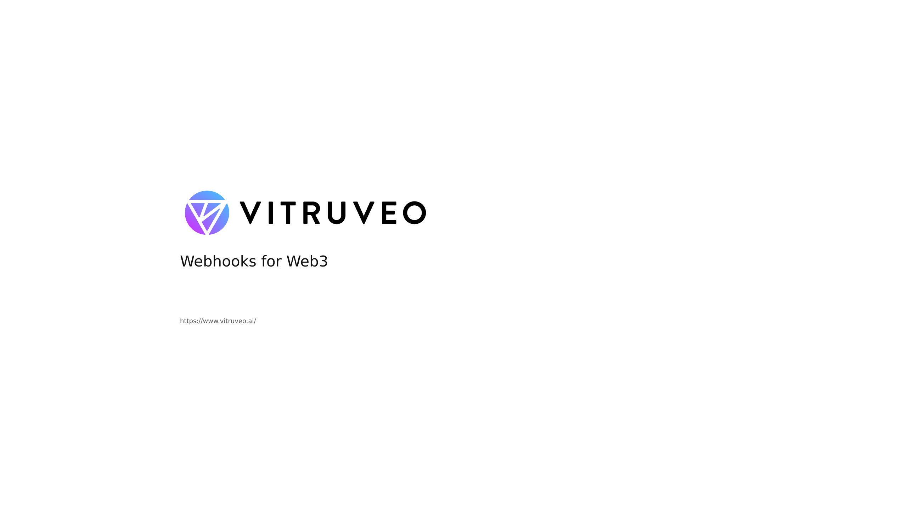</a>

## YouTube video thumbnail template

1280 × 720 px · [PNG](../social-templates/03-Vitruveo/YouTube/youtube-video-thumbnail.png) · [Editable SVG](../social-templates/03-Vitruveo/YouTube/youtube-video-thumbnail.svg)

<a href="../social-templates/03-Vitruveo/YouTube/youtube-video-thumbnail.png">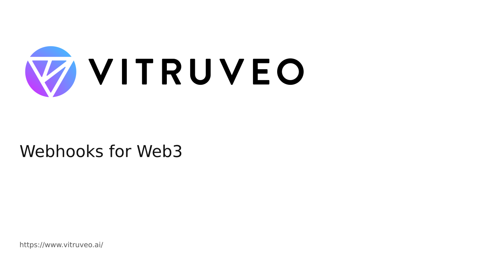</a>

## TikTok content cover

1080 × 1920 px · [PNG](../social-templates/03-Vitruveo/TikTok/tiktok-vertical-cover.png) · [Editable SVG](../social-templates/03-Vitruveo/TikTok/tiktok-vertical-cover.svg)

<a href="../social-templates/03-Vitruveo/TikTok/tiktok-vertical-cover.png">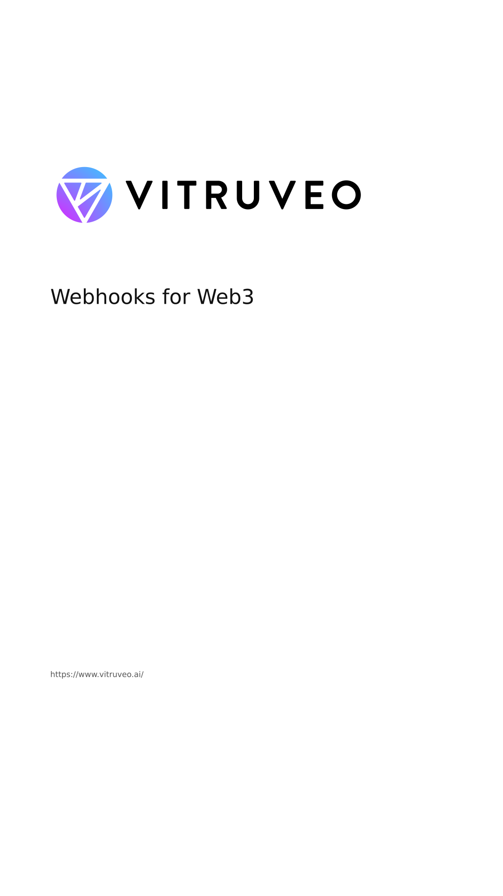</a>

## Instagram square feed post

1080 × 1080 px · [PNG](../social-templates/03-Vitruveo/Instagram/instagram-feed-square.png) · [Editable SVG](../social-templates/03-Vitruveo/Instagram/instagram-feed-square.svg)

<a href="../social-templates/03-Vitruveo/Instagram/instagram-feed-square.png">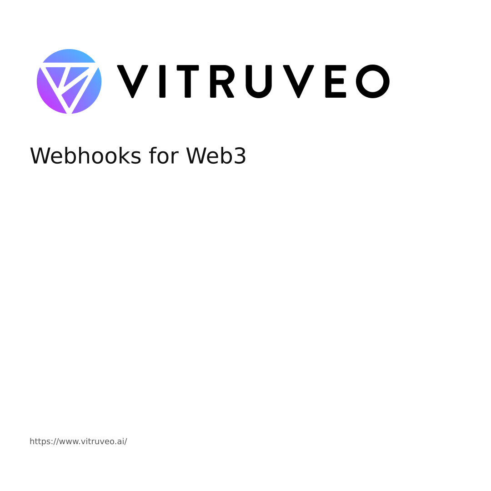</a>

## Instagram portrait feed post

1080 × 1350 px · [PNG](../social-templates/03-Vitruveo/Instagram/instagram-feed-portrait.png) · [Editable SVG](../social-templates/03-Vitruveo/Instagram/instagram-feed-portrait.svg)

<a href="../social-templates/03-Vitruveo/Instagram/instagram-feed-portrait.png">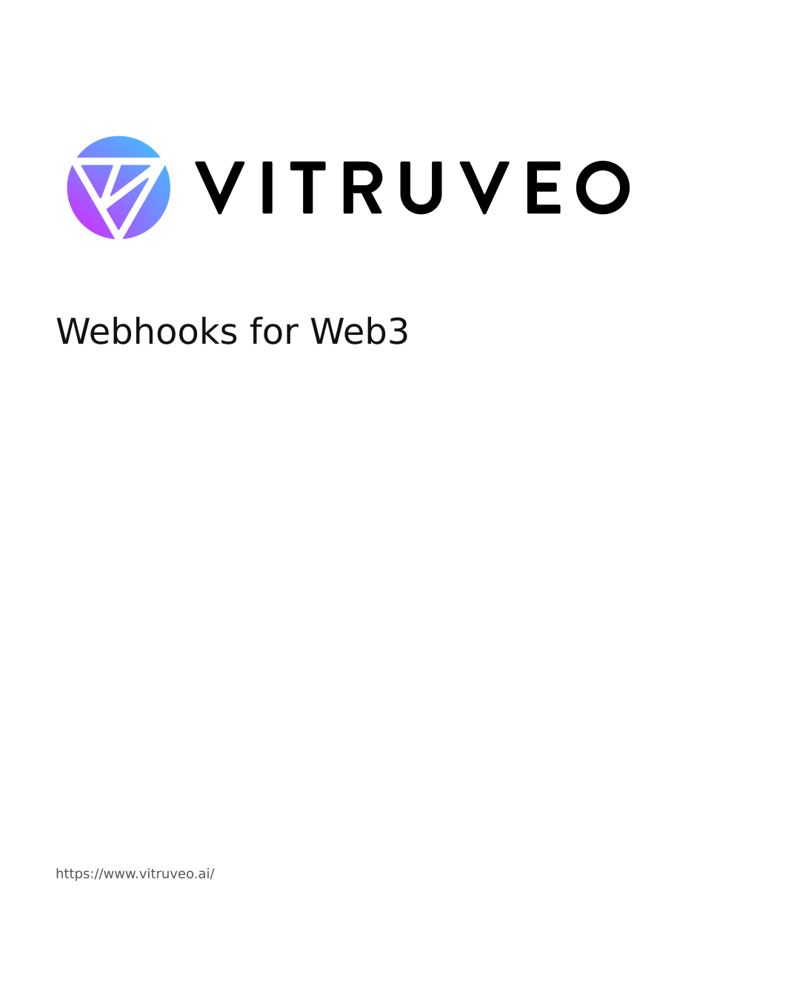</a>

## Instagram Story / Reel cover

1080 × 1920 px · [PNG](../social-templates/03-Vitruveo/Instagram/instagram-story-reel-cover.png) · [Editable SVG](../social-templates/03-Vitruveo/Instagram/instagram-story-reel-cover.svg)

<a href="../social-templates/03-Vitruveo/Instagram/instagram-story-reel-cover.png">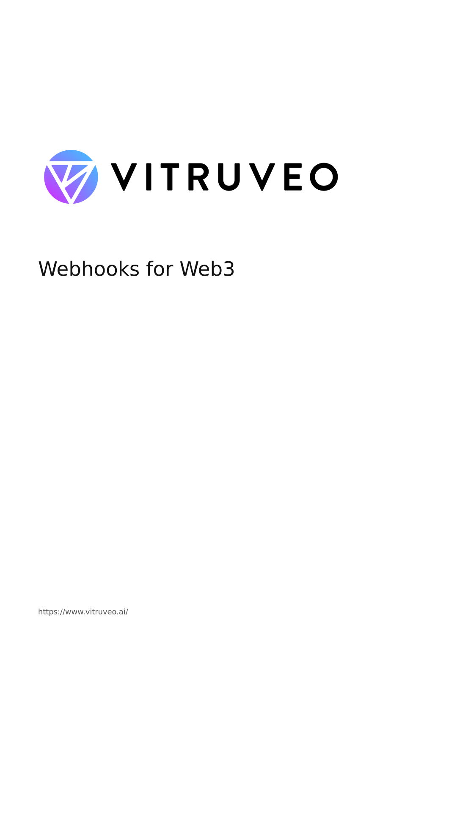</a>

## Rumble channel backsplash

3600 × 600 px · [PNG](../social-templates/03-Vitruveo/Rumble/rumble-channel-backsplash.png) · [Editable SVG](../social-templates/03-Vitruveo/Rumble/rumble-channel-backsplash.svg)

