# V2 — Vitruveo / Additional templates

[V2 gallery index](../GALLERY.md) · [Usage guide](../USAGE-GUIDE.md) · [Website-copy sources](../reports/COPY-SOURCES.md)

These are general editable canvases. Empty white areas are deliberately available for the owner’s existing imagery. The preview labels describe their intended use; they are not additional marketing copy.

[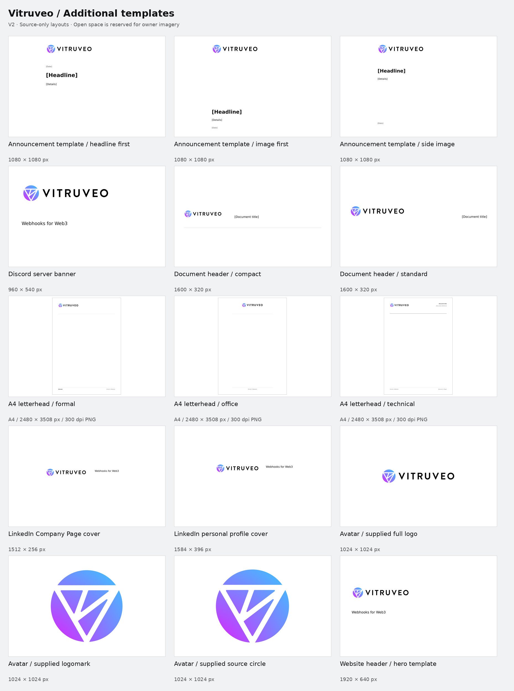](../previews/supplemental-vitruveo-contact-sheet.png)

## Announcement template / headline first

1080 × 1080 px · [PNG](../supplemental/vitruveo/Announcements/vitruveo-announcement-headline-first.png) · [Editable SVG](../supplemental/vitruveo/Announcements/vitruveo-announcement-headline-first.svg)

<a href="../supplemental/vitruveo/Announcements/vitruveo-announcement-headline-first.png">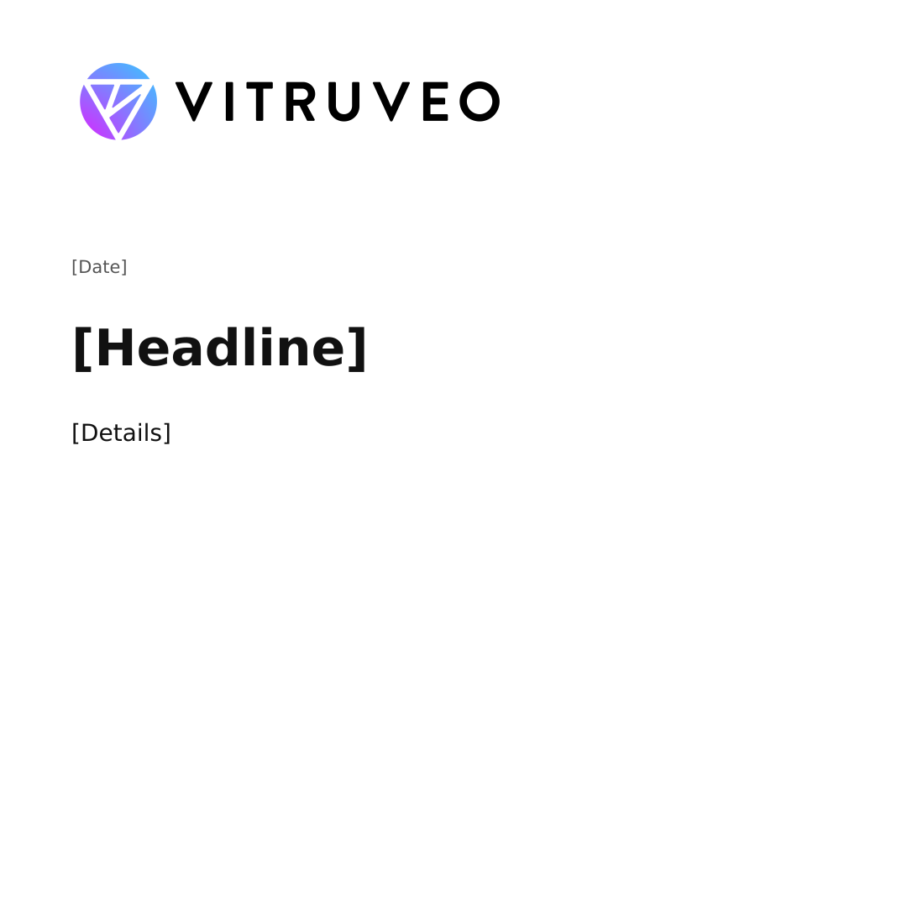</a>

## Announcement template / image first

1080 × 1080 px · [PNG](../supplemental/vitruveo/Announcements/vitruveo-announcement-image-first.png) · [Editable SVG](../supplemental/vitruveo/Announcements/vitruveo-announcement-image-first.svg)

<a href="../supplemental/vitruveo/Announcements/vitruveo-announcement-image-first.png">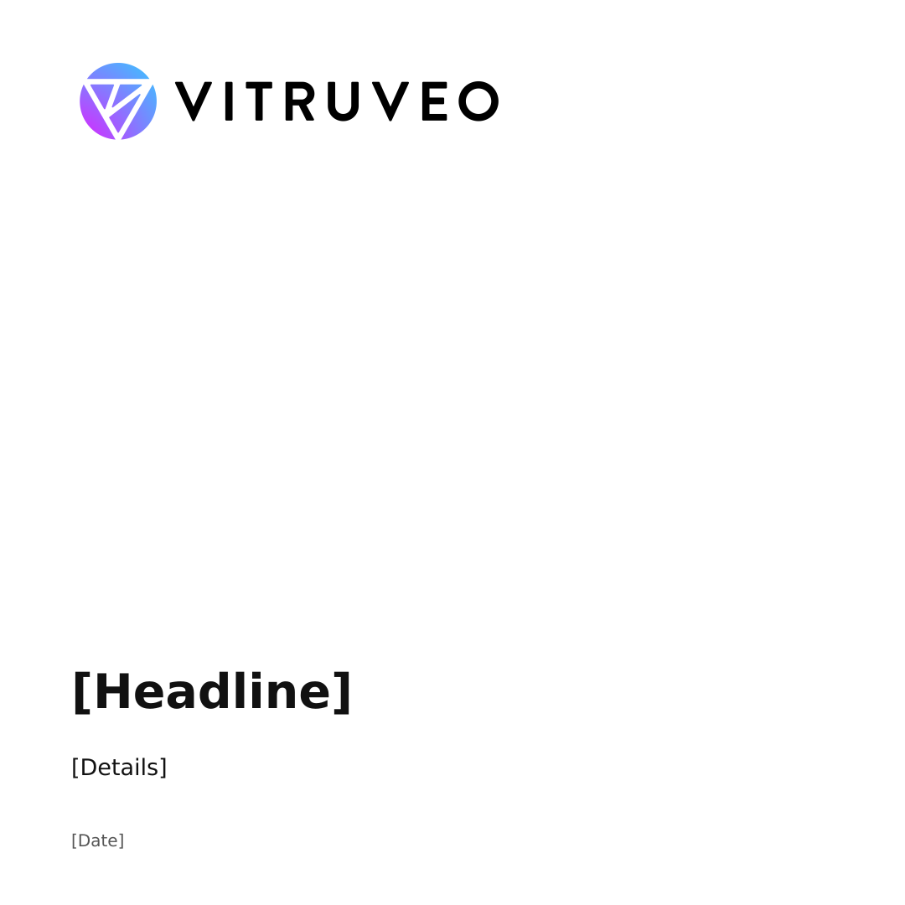</a>

## Announcement template / side image

1080 × 1080 px · [PNG](../supplemental/vitruveo/Announcements/vitruveo-announcement-side-image.png) · [Editable SVG](../supplemental/vitruveo/Announcements/vitruveo-announcement-side-image.svg)

<a href="../supplemental/vitruveo/Announcements/vitruveo-announcement-side-image.png">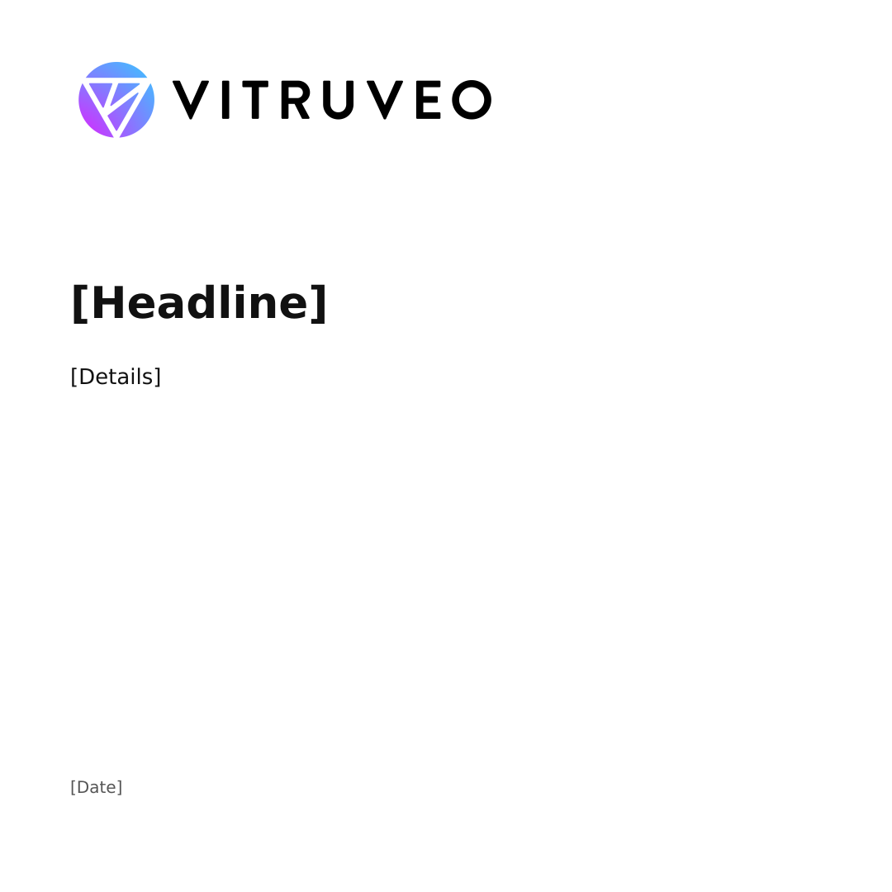</a>

## Discord server banner

960 × 540 px · [PNG](../supplemental/vitruveo/Discord-Server/vitruveo-discord-server-banner.png) · [Editable SVG](../supplemental/vitruveo/Discord-Server/vitruveo-discord-server-banner.svg)

<a href="../supplemental/vitruveo/Discord-Server/vitruveo-discord-server-banner.png">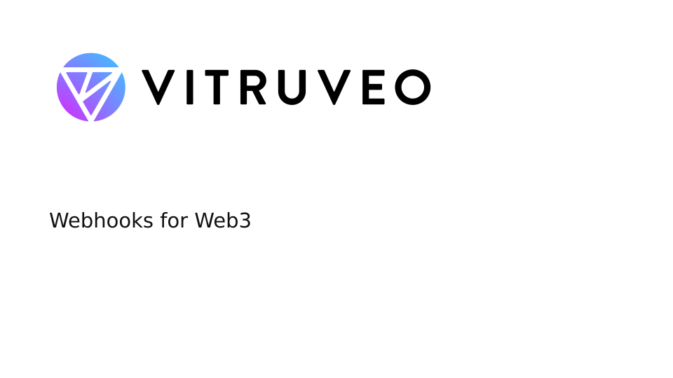</a>

## Document header / compact

1600 × 320 px · [PNG](../supplemental/vitruveo/Document-Headers/vitruveo-document-header-compact.png) · [Editable SVG](../supplemental/vitruveo/Document-Headers/vitruveo-document-header-compact.svg)

<a href="../supplemental/vitruveo/Document-Headers/vitruveo-document-header-compact.png">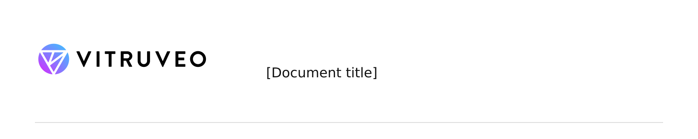</a>

## Document header / standard

1600 × 320 px · [PNG](../supplemental/vitruveo/Document-Headers/vitruveo-document-header-standard.png) · [Editable SVG](../supplemental/vitruveo/Document-Headers/vitruveo-document-header-standard.svg)

<a href="../supplemental/vitruveo/Document-Headers/vitruveo-document-header-standard.png">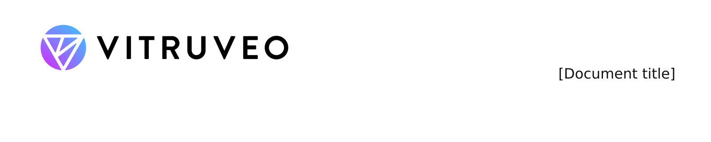</a>

## A4 letterhead / formal

A4 / 2480 × 3508 px / 300 dpi PNG · [PNG](../supplemental/vitruveo/Letterheads/vitruveo-letterhead-formal-A4.png) · [Editable SVG](../supplemental/vitruveo/Letterheads/vitruveo-letterhead-formal-A4.svg) · [PDF](../supplemental/vitruveo/Letterheads/vitruveo-letterhead-formal-A4.pdf) · [Editable DOCX](../supplemental/vitruveo/Letterheads/vitruveo-letterhead-formal-A4.docx)

<a href="../supplemental/vitruveo/Letterheads/vitruveo-letterhead-formal-A4.png">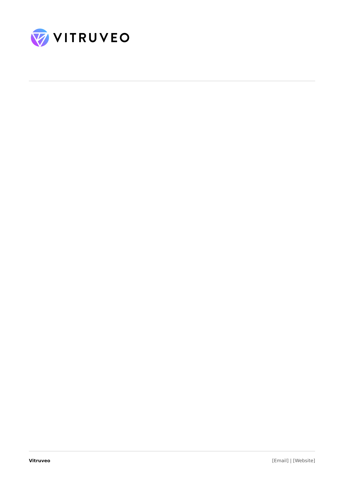</a>

## A4 letterhead / office

A4 / 2480 × 3508 px / 300 dpi PNG · [PNG](../supplemental/vitruveo/Letterheads/vitruveo-letterhead-office-A4.png) · [Editable SVG](../supplemental/vitruveo/Letterheads/vitruveo-letterhead-office-A4.svg) · [PDF](../supplemental/vitruveo/Letterheads/vitruveo-letterhead-office-A4.pdf) · [Editable DOCX](../supplemental/vitruveo/Letterheads/vitruveo-letterhead-office-A4.docx)

<a href="../supplemental/vitruveo/Letterheads/vitruveo-letterhead-office-A4.png">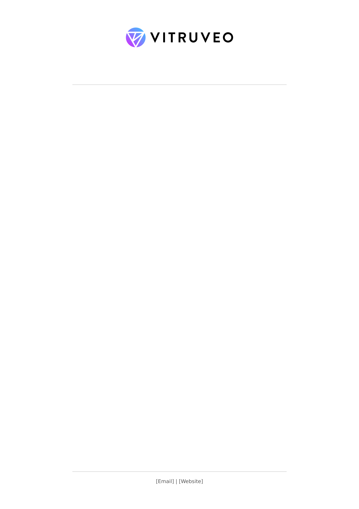</a>

## A4 letterhead / technical

A4 / 2480 × 3508 px / 300 dpi PNG · [PNG](../supplemental/vitruveo/Letterheads/vitruveo-letterhead-technical-A4.png) · [Editable SVG](../supplemental/vitruveo/Letterheads/vitruveo-letterhead-technical-A4.svg) · [PDF](../supplemental/vitruveo/Letterheads/vitruveo-letterhead-technical-A4.pdf) · [Editable DOCX](../supplemental/vitruveo/Letterheads/vitruveo-letterhead-technical-A4.docx)

<a href="../supplemental/vitruveo/Letterheads/vitruveo-letterhead-technical-A4.png">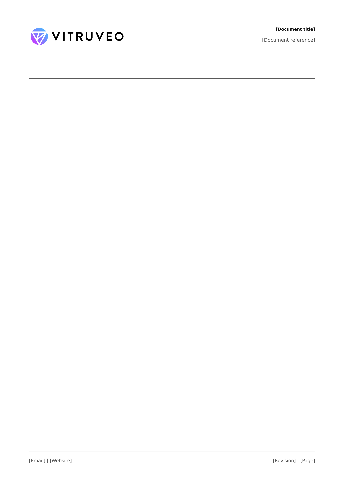</a>

## LinkedIn Company Page cover

1512 × 256 px · [PNG](../supplemental/vitruveo/LinkedIn/vitruveo-linkedin-company.png) · [Editable SVG](../supplemental/vitruveo/LinkedIn/vitruveo-linkedin-company.svg)

## LinkedIn personal profile cover

1584 × 396 px · [PNG](../supplemental/vitruveo/LinkedIn/vitruveo-linkedin-personal.png) · [Editable SVG](../supplemental/vitruveo/LinkedIn/vitruveo-linkedin-personal.svg)

<a href="../supplemental/vitruveo/LinkedIn/vitruveo-linkedin-personal.png">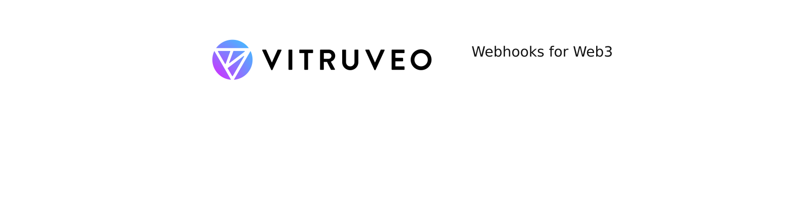</a>

## Avatar / supplied full logo

1024 × 1024 px · [PNG](../supplemental/vitruveo/Profile-Images/vitruveo-avatar-full-logo.png) · [Editable SVG](../supplemental/vitruveo/Profile-Images/vitruveo-avatar-full-logo.svg)

<a href="../supplemental/vitruveo/Profile-Images/vitruveo-avatar-full-logo.png">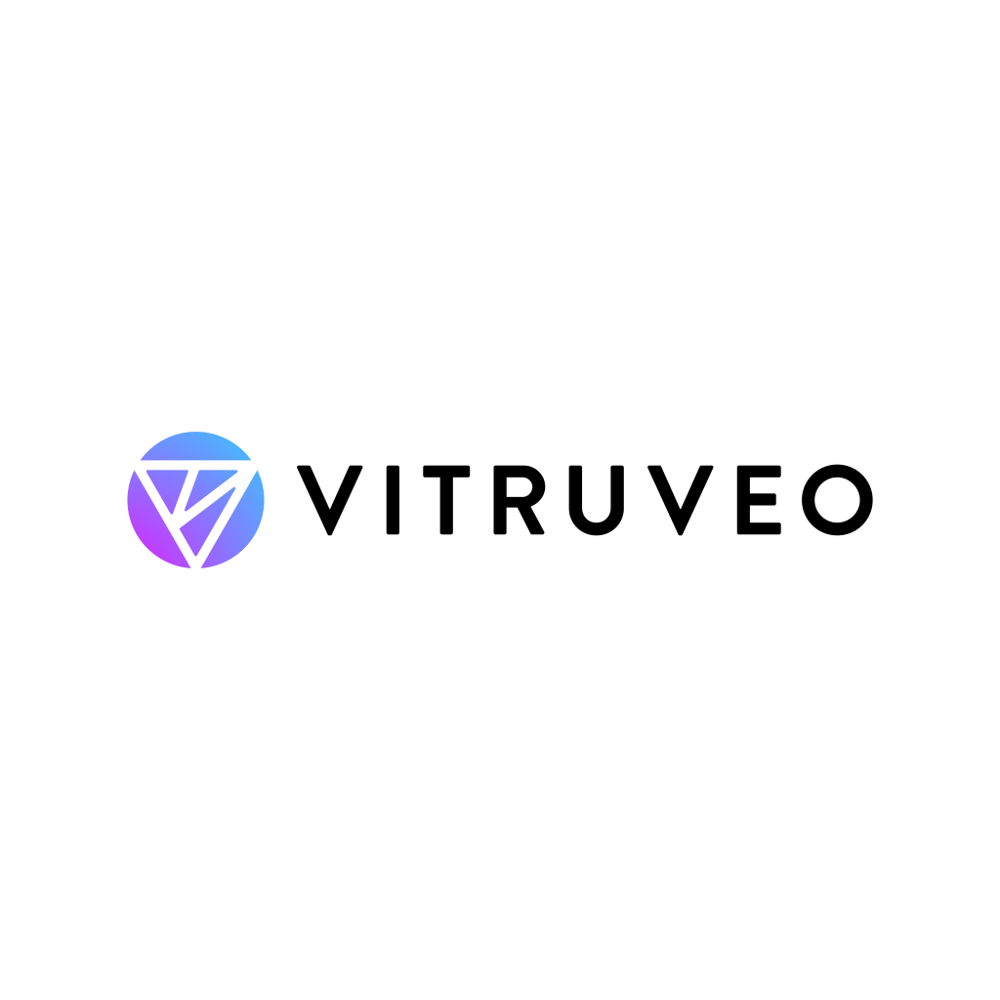</a>

## Avatar / supplied logomark

1024 × 1024 px · [PNG](../supplemental/vitruveo/Profile-Images/vitruveo-avatar-logomark.png) · [Editable SVG](../supplemental/vitruveo/Profile-Images/vitruveo-avatar-logomark.svg)

<a href="../supplemental/vitruveo/Profile-Images/vitruveo-avatar-logomark.png">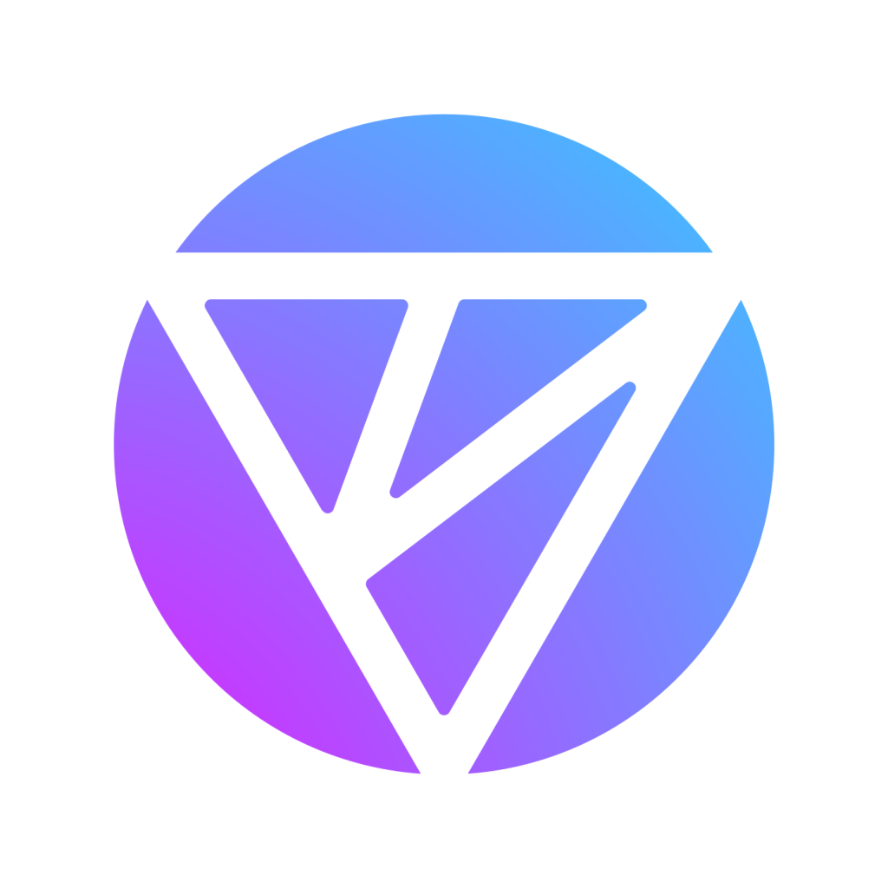</a>

## Avatar / supplied source circle

1024 × 1024 px · [PNG](../supplemental/vitruveo/Profile-Images/vitruveo-avatar-source-circle.png) · [Editable SVG](../supplemental/vitruveo/Profile-Images/vitruveo-avatar-source-circle.svg)

<a href="../supplemental/vitruveo/Profile-Images/vitruveo-avatar-source-circle.png">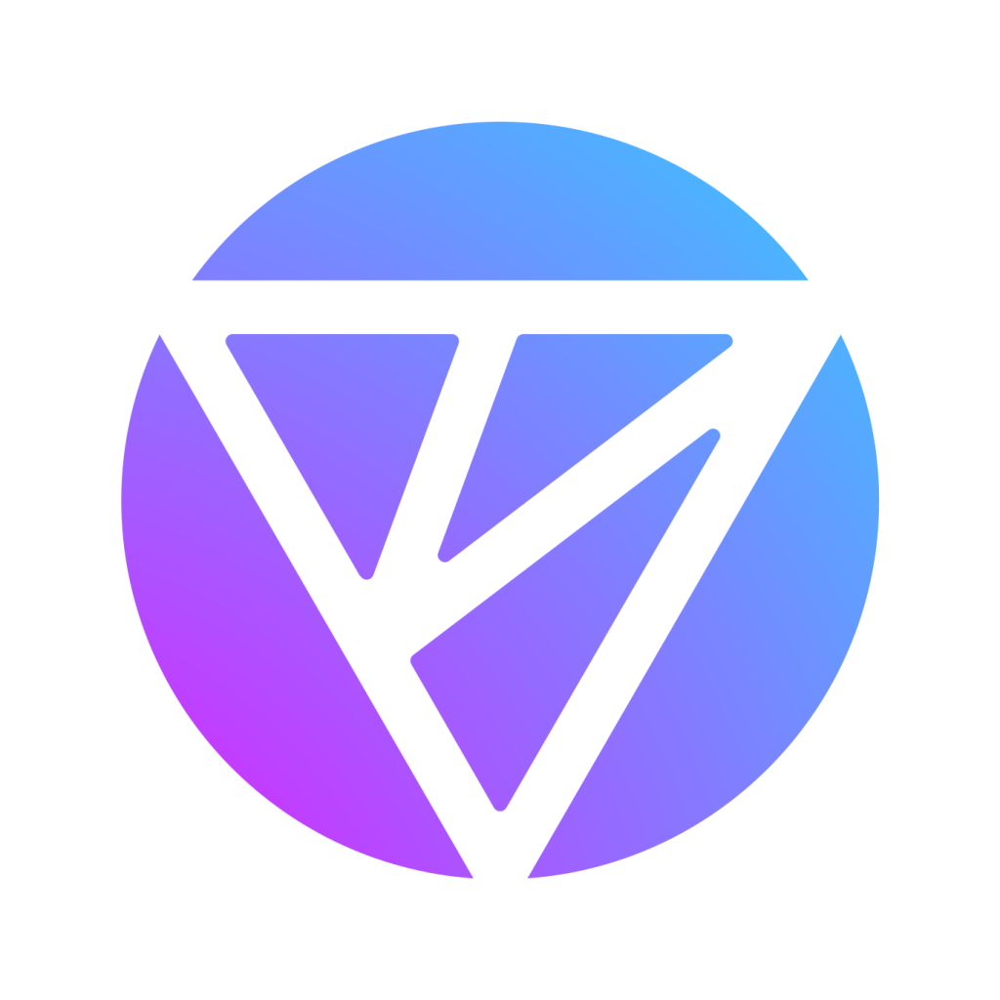</a>

## Website header / hero template

1920 × 640 px · [PNG](../supplemental/vitruveo/Website/vitruveo-website-hero.png) · [Editable SVG](../supplemental/vitruveo/Website/vitruveo-website-hero.svg)

